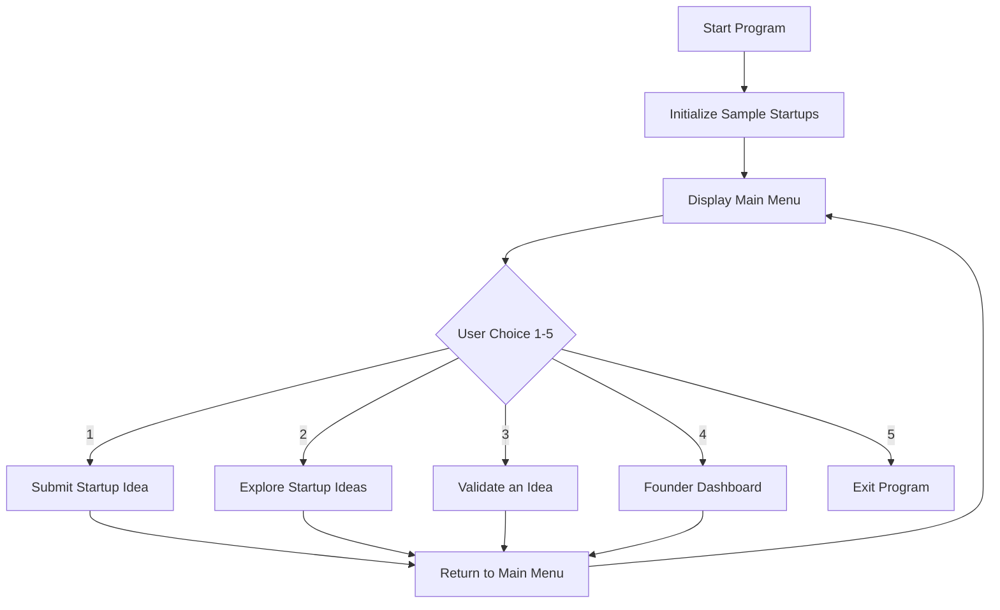

# TestMint — Validate Before You Build

A menu-driven startup idea validation system built in C for the first-year C Programming Mini Hackathon.

---

## Team Information

* **Project Name:** TestMint
* **Tagline:** Validate Before You Build.
* **Batch:** Batch 20
* **Team Name:** TestMint

### Team Members

| Name | SAP ID | Batch | Role |
|---|:---:|:---:|---|
| **Manan Walia** | 590036141 | 20 | Validation calculations, scoring logic & project lead |
| **Poornika Pant** | 590032465 | 20 | Structures (`struct`), explore module & founder dashboard |
| **Aryan Gangwar** | 590042393 | 20 | Console input handling, validation checks & test cases |

> **Note on Problem Statement:**  
> TestMint is a self-proposed problem statement. Faculty approval is required for self-proposed topics as per the hackathon guidelines.

---

## Problem Statement

A common reason early startups fail is that founders spend months writing code and building full products before finding out if any customers actually want what they are making. Building software without talking to users or testing demand leads to wasted time and effort.

## Proposed Solution

**TestMint** is a console application written in C that helps founders validate startup ideas before writing any product code. Founders can register their startup ideas across different categories, and users can browse ideas and provide three signals:

1. **Interested / Pass Vote:** Indicates whether the user finds the problem relevant.
2. **Purchase Intent:** Shows whether the user would actually pay for or pre-order the solution.
3. **Written Feedback:** Direct text advice, suggestions, or concerns for the founder.

The program calculates an overall validation score (0 to 100) using a weighted formula and gives founders an official verdict:
* **STRONG DEMAND** (Score >= 75) — Good candidate to start building an MVP.
* **NEEDS MORE VALIDATION** (Score 40 to 74.99) — Needs refinement in value proposition.
* **WEAK DEMAND** (Score < 40) — Recommend pivoting or rethinking target audience.
* **NOT ENOUGH DATA YET** (0 Votes) — Awaiting initial user responses.

---

## Features

1. **Submit Startup Idea:** Add a new idea with founder name, startup name, category, problem statement, proposed solution, and target audience.
2. **Explore Startup Ideas:** View a table of all submitted startups with current scores and verdicts, and inspect detailed cards for each idea.
3. **Validate an Idea:** Cast an Interested or Pass vote, record purchase intent, and leave written feedback.
4. **Founder Dashboard:** View detailed analytics for any idea, including vote counts, interest rate, purchase intent rate, score breakdown, and all feedback comments.
5. **Input Validation:** Safe string reading with `fgets()`, buffer flushing, range checks on integers, and protection against division by zero.
6. **Pre-Seeded Concepts:** Comes loaded with three sample startups (PaySplit in FinTech, KhetiMitra in AgriTech, and GSTEase in SaaS) for testing.

---

## C Programming Concepts Used

| C Concept | How It Is Used in TestMint |
|---|---|
| **Variables & Data Types** | `int` for counters/IDs, `float` for percentages and scores, `char` arrays for text |
| **Operators** | Arithmetic (`+`, `-`, `*`, `/`), relational (`>=`, `<`, `==`, `!=`), logical (`&&`, `\|\|`, `!`), and compound operators |
| **Conditional Statements** | `if`, `else if`, and `else` for input checks, menu boundaries, and verdict scoring |
| **Switch-Case** | Handles the 5 main menu options with a `default` case for invalid selections |
| **Loops** | `do-while` for keeping the program running until exit, `for` to iterate over arrays of startups and feedback, `while` for input validation loops |
| **Arrays (1D & 2D)** | `CATEGORIES[]` array for startup sectors, character buffers for strings |
| **Strings & Character Arrays** | Sized character arrays (`char name[100]`), safe reading with `fgets()`, newline removal, `strlen`, `strcpy`, `strncpy` |
| **User-Defined Functions** | Modular functions for submitting, exploring, validating, calculating, and displaying |
| **Pointers (Pass-by-Reference)** | `int *count`, `float *interestRate`, `float *purchaseRate`, `float *score` to return multiple calculated values |
| **Structures (`struct`)** | `Feedback` structure for user comments, `Startup` structure for complete startup records |
| **Nested Structures** | `Feedback feedbacks[MAX_FEEDBACK]` array nested inside the `Startup` structure |
| **Array of Structures** | `Startup startups[MAX_STARTUPS]` to store multiple startup ideas in memory |
| **Input Stream Validation** | `readInteger()` and `readSafeString()` check bounds and clear the stdin buffer with `clearInputBuffer()` |
| **Division-by-Zero Safeguard** | `if (totalVotes == 0)` check in `calculateMetrics()` to prevent runtime crashes |

---

## Validation Formula

### 1. Total Votes
$$\text{Total Votes} = \text{Interested Votes} + \text{Pass Votes}$$

### 2. Interest Rate
$$\text{Interest Rate} = \left(\frac{\text{Interested Votes}}{\text{Total Votes}}\right) \times 100$$

### 3. Purchase Intent Rate
$$\text{Purchase Intent Rate} = \left(\frac{\text{Purchase Intent Votes}}{\text{Total Votes}}\right) \times 100$$

### 4. Validation Score
$$\text{Validation Score} = (\text{Interest Rate} \times 0.60) + (\text{Purchase Intent Rate} \times 0.40)$$

*Note: If Total Votes equals 0, the score is set to 0.0 directly to prevent division by zero.*

### 5. Verdict Classification

| Score Range | Verdict | Recommendation |
|:---:|:---:|---|
| **75.0 – 100.0** | **STRONG DEMAND** | Users show high interest and willingness to pay. Proceed to build MVP. |
| **40.0 – 74.99** | **NEEDS MORE VALIDATION** | Moderate interest. Sharpen value proposition before writing code. |
| **Below 40.0** | **WEAK DEMAND** | Weak customer demand. Interview users or pivot. |
| **Total Votes = 0** | **NOT ENOUGH DATA YET** | Newly registered idea with no votes yet. |

---

## Program Flow



An architecture diagram is also saved as [flowchart.png](flowchart.png).

---

## How to Compile and Run

### Requirements
Any standard C compiler (GCC, Clang, or MSVC) supporting C99.

### Windows (GCC)
```bash
# Compile
gcc -Wall -Wextra -std=c99 testmint.c -o testmint.exe

# Run
.\testmint.exe
```

### Linux / macOS
```bash
# Compile
gcc -Wall -Wextra -std=c99 testmint.c -o testmint

# Run
./testmint
```

---

## Sample Outputs & Test Runs

### 1. Main Menu
```text
========================================
              TESTMINT                  
       VALIDATE BEFORE YOU BUILD        
========================================
1. Submit Startup Idea
2. Explore Startup Ideas
3. Validate an Idea
4. Founder Dashboard
5. Exit
========================================
Enter your choice (1-5): 
```

### 2. Explore Startups (Option 2)
```text
--------------------------------------------------------------------------------
                         EXPLORE STARTUP IDEAS                                  
--------------------------------------------------------------------------------
ID   | Startup Name     | Founder      | Category   | Score  | Verdict                 
--------------------------------------------------------------------------------
#1   | PaySplit         | Aarav Mehta  | FinTech    |  72.9  | NEEDS MORE VALIDATION   
#2   | KhetiMitra       | Priya Deshmu | AgriTech   |  76.1  | STRONG DEMAND           
#3   | GSTEase          | Suresh CA    | SaaS       |  35.3  | WEAK DEMAND             
--------------------------------------------------------------------------------
```

### 3. Validating an Idea (Option 3)
```text
Validating "PaySplit" (by Aarav Mehta):
Problem  : Flatmates struggle to split rent, groceries and Wi-Fi over WhatsApp...
Solution : UPI-native shared ledger that automatically splits bills...
--------------------------------------------------------

[Step 1/3] Would you use this product?
  1. Yes - Interested (I would use this)
  2. No  - Pass (Not interested)
Your vote (1-2): 1
-> Recorded: INTERESTED vote added.

[Step 2/3] Would you pay / pre-order this solution?
  1. Yes - I would pay for this (Purchase Intent)
  2. No  - Not ready to purchase
Your choice (1-2): 1
-> Recorded: PURCHASE INTENT logged.

[Step 3/3] Would you like to leave constructive feedback for Aarav Mehta?
  1. Yes, leave written feedback
  2. Skip feedback
Your choice (1-2): 1
Your Name/Role : Aryan Gangwar
Your Feedback  : Direct UPI settlement will make this spread quickly in hostels.
-> Feedback successfully sent to Aarav Mehta!

--------------------------------------------------------
>>> THANK YOU FOR VALIDATING!
Updated Validation Score : 73.1 / 100
Current Verdict          : NEEDS MORE VALIDATION
--------------------------------------------------------
```

### 4. Founder Dashboard (Option 4)
```text
========================================================================
                  TESTMINT STARTUP VALIDATION REPORT                     
========================================================================
 Startup Name    : PaySplit
 Founder         : Aarav Mehta
 Category        : FinTech
 Total Views     : 413
------------------------------------------------------------------------
 1. VOTING BREAKDOWN:
    - Total Votes Cast      : 287
    - Interested Votes      : 241
    - Pass / Not Interested : 46
    - Interest Rate         : 83.97%
------------------------------------------------------------------------
 2. PURCHASE INTENT BREAKDOWN:
    - Purchase Intent Count : 159
    - Purchase Intent Rate  : 55.40%
------------------------------------------------------------------------
 3. VALIDATION FORMULA & SCORE:
    Formula: (Interest Rate * 0.60) + (Purchase Intent Rate * 0.40)
    Math   : (83.97 * 0.60) + (55.40 * 0.40)
             = 50.38 + 22.16
    FINAL VALIDATION SCORE  : 72.5 / 100
------------------------------------------------------------------------
 4. OFFICIAL VERDICT:
    ==> [ NEEDS MORE VALIDATION ] <==
    Guidance: [REFINE] Promising initial interest, but purchase intent requires
              further refinement before heavy software investment.
------------------------------------------------------------------------
 5. COMMUNITY FEEDBACK LOG (3 notes):
    * "Our flat uses messy Google Sheets. If reminders are automated I will switch tomorrow." - Riya S. (Student)
    * "Direct UPI settle-up in the same screen is the killer feature." - Karthik N. (Engineer)
    * "Direct UPI settlement will make this spread quickly in hostels." - Aryan Gangwar
========================================================================
```

### 5. Input Validation Handling
If non-numeric characters or out-of-range numbers are typed:
```text
Enter your choice (1-5): abc
[Error] Invalid input. Please enter a valid number.
Enter your choice (1-5): 9
[Error] Value out of range. Enter a number between 1 and 5.
Enter your choice (1-5): 
```

---

## Repository Files

```text
Batch20_TeamPending_TestMint/
├── README.md          # Main project documentation and test outputs
├── testmint.c         # Complete C source code
├── presentation.pptx  # Slide deck for presentation and evaluation review
└── flowchart.png      # Architecture diagram image
```

---

## Notes on Implementation

* **Pure C Implementation:** This is a standalone console application written entirely in standard C99 (`testmint.c`).
* **Memory Management:** Startup ideas and feedbacks are stored in memory using arrays of structures. It does not use any databases or external web APIs.
* **Validation Signals:** "Purchase Intent" is a numerical validation metric indicating customer interest; it does not process any real financial transactions.
