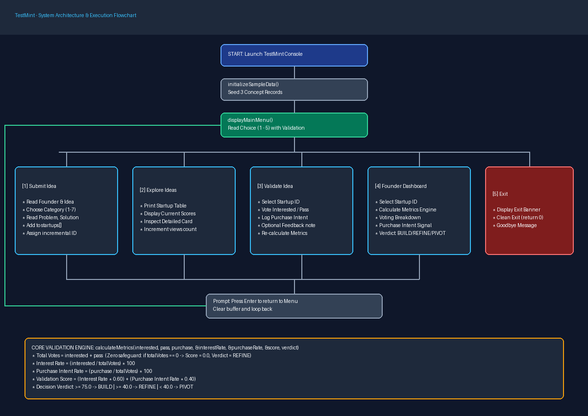
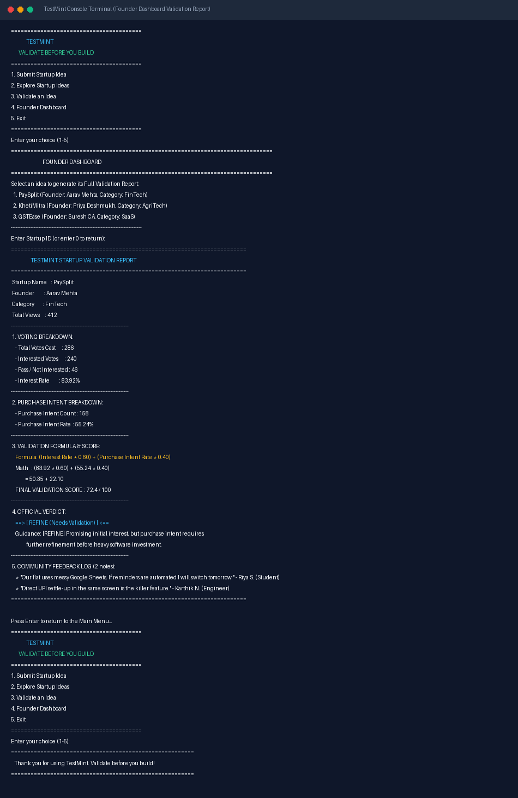

# TestMint — Validate Before You Build

> **C Programming Mini Hackathon Project**  
> *A terminal-based startup idea validation and market-signal platform implemented in C.*

[](testmint.c)
[](testmint.c)
[](SUBMISSION_CHECKLIST.md)

---

## 👥 Project & Team Identification

* **Project Name:** **TestMint**
* **Tagline:** *Validate Before You Build.*
* **Project Type:** C Programming Mini Hackathon Assessment
* **Batch:** **Batch 20**
* **Team Number:** `TEAM_NUMBER_PENDING` *(Awaiting official allocation)*
* **Repository Naming:** `Batch20_TeamPending_TestMint`

### 👨‍💻 Team Members

| Name | SAP ID | Batch | Role / Module Ownership |
|---|:---:|:---:|---|
| **Manan Walia** *(Lead)* | `590036141` | Batch 20 | Validation Engine, Mathematical Formulas, Decision Matrix |
| **Poornika Pant** | `590032465` | Batch 20 | Data Modeling (`struct`), Explore Catalog, Founder Dashboard |
| **Aryan Gangwar** | `590042393` | Batch 20 | Console I/O, Defensive Validation, Buffer Handling, Test Runs |

---

## 📌 Problem Statement & Motivation

### The Problem
Aspiring entrepreneurs frequently invest significant financial resources and hundreds of development hours building software applications before knowing whether real customers actually want or need them. This disconnect leads to high startup failure rates caused by building solutions for non-existent market problems.

### The Solution: TestMint
**TestMint** is an interactive, menu-driven console system designed to provide objective, signal-driven customer validation before any software development begins. Founders register startup concepts across recognized industry sectors, and prospective users evaluate concepts through a three-stage validation flow:
1. **Interest Signal:** Vote *Interested* vs. *Pass* to measure problem relevance.
2. **Commercial Intent:** Record purchase/pre-order willingness to test economic commitment.
3. **Qualitative Feedback:** Provide written suggestions, friction points, or praise.

The system synthesizes these responses using a weighted validation formula, generating a normalized score ($0 - 100$) and an official decision verdict:
* **BUILD** (Strong Demand: Score $\ge 75.0$)
* **REFINE** (Needs Validation: $40.0 \le \text{Score} < 75.0$)
* **PIVOT** (Weak Demand: Score $< 40.0$)

---

## 🎯 Program Objectives & Key Features

### Objectives
* Apply core first-year C programming concepts to solve a practical, real-world entrepreneurial challenge.
* Implement a robust, defensive console application resilient against illegal inputs and edge cases.
* Structure modular code following clean software engineering standards (single responsibility, clear function prototypes, pass-by-reference pointers).

### Key Features
1. **Submit Startup Idea:** Dynamic registration of startup concepts with validation for non-empty text, category selection ($1 - 7$), and unique ID generation.
2. **Explore Startup Ideas:** Tabular overview of all live concepts showing IDs, categories, scores, and verdicts, plus detailed inspection cards for individual concepts.
3. **Validate an Idea:** Three-step voting flow capturing user interest, purchase intent, and optional written feedback with automatic view tracking.
4. **Founder Dashboard:** Full analytical report displaying vote distributions, mathematical breakdown of the weighted validation formula, decision verdict, and qualitative community notes.
5. **Pre-Seeded Real-World Concepts:** Pre-loaded with three representative startup concepts (PaySplit, KhetiMitra, GSTEase) enabling immediate testing upon launch.
6. **Robust Input Safeguards:** Input buffer flushing (`clearInputBuffer`), range-bound integer validation (`readInteger`), safe string reading (`fgets` with trailing newline stripping), and division-by-zero protection.

---

## 🧮 Mathematical Model & Decision Engine

### 1. Interest Rate ($I_{\text{rate}}$)
$$\text{Total Votes} = \text{Interested Votes} + \text{Pass Votes}$$

$$I_{\text{rate}} = \left(\frac{\text{Interested Votes}}{\text{Total Votes}}\right) \times 100$$

### 2. Purchase Intent Rate ($P_{\text{rate}}$)
$$P_{\text{rate}} = \left(\frac{\text{Purchase Intent Signals}}{\text{Total Votes}}\right) \times 100$$

### 3. Weighted Validation Score ($S$)
$$S = (I_{\text{rate}} \times 0.60) + (P_{\text{rate}} \times 0.40)$$

*Note: If $\text{Total Votes} = 0$, $S = 0.0$ and division by zero is safely prevented.*

### 4. Decision Matrix

| Validation Score Range | Decision Verdict | Strategic Action for Founder |
|:---:|:---:|---|
| **$S \ge 75.0$** | **`BUILD (Strong Demand)`** | Enthusiastic user base and clear willingness to pay. Proceed directly to building an MVP. |
| **$40.0 \le S < 75.0$** | **`REFINE (Needs Validation)`** | Initial curiosity detected, but commercial purchase intent is insufficient. Refine value proposition. |
| **$S < 40.0$** | **`PIVOT (Weak Demand)`** | Weak customer signal. Conduct deeper customer interviews, adjust target audience, or pivot. |
| **$\text{Total Votes} = 0$** | **`REFINE (No Votes Yet)`** | Newly registered idea awaiting its first community validation signals. |

---

## 🎓 C Programming Concepts Demonstrated

| C Programming Concept | Implementation in TestMint | Code Reference |
|---|---|:---:|
| **Variables & Fundamental Data Types** | `int` for counters/IDs, `float` for percentages and scores, `char` arrays for textual content. | Lines 27–54, 82–85 |
| **Operators** | Arithmetic (`+`, `-`, `*`, `/`), Relational (`>=`, `<`, `==`, `!=`), Logical (`&&`, `\|\|`, `!`), Compound (`+=`, `++`). | Lines 156–164, 245–265 |
| **Control Structures (`if / else`)** | Conditional branches for input validation, score classification, and menu routing. | Lines 181–189, 259–265 |
| **Selection Control (`switch-case`)** | 5-way menu dispatch with dedicated `default` fallback for invalid entries. | Lines 105–126 |
| **Iteration Loops (`for`, `while`, `do-while`)** | `do-while` for main app loop, `for` for iterating startup/feedback arrays, `while` for input validation loops. | Lines 100–132, 151–169, 332–345 |
| **1D & 2D Arrays** | Array of category strings (`const char *CATEGORIES[]`), character buffers for names and descriptions. | Lines 57–66, 40–54 |
| **Strings & Character Arrays** | Sized character arrays (`char name[100]`), safe reading with `fgets`, newline stripping, `strlen`, `strcpy`, `strncpy`. | Lines 150–170, 294–295 |
| **Modular Functions & Pointers** | Pass-by-value and pass-by-reference pointers (`int *count`, `float *score`, `Startup *s`) for returning multi-value calculations. | Lines 73–86, 242–266 |
| **User-Defined Structures (`struct`)** | Hierarchical data modeling with `Feedback` struct nested inside `Startup` struct. | Lines 34–54 |
| **Array of Structures** | In-memory collection `Startup startups[MAX_STARTUPS]` managing records. | Lines 93, 272–311 |
| **Input Stream & Boundary Validation** | Strict range checking on numeric inputs, buffer clearing, and `feof()` safety to prevent infinite loops. | Lines 142–147, 173–191 |
| **Division-by-Zero Safeguard** | Explicit check `if (totalVotes == 0)` ensuring zero crashes on unvoted ideas. | Lines 247–253 |

---

## 🏗️ System Architecture & Execution Flow

### High-Level Flowchart


### Pseudocode (Validation Logic)
```text
FUNCTION calculateMetrics(interested, pass, purchase, OUT iRate, OUT pRate, OUT score, OUT verdict):
    totalVotes = interested + pass
    
    IF totalVotes EQUALS 0 THEN:
        iRate = 0.0
        pRate = 0.0
        score = 0.0
        verdict = "REFINE (No Votes Yet)"
        RETURN
    END IF
    
    iRate = (interested / totalVotes) * 100.0
    pRate = (purchase / totalVotes) * 100.0
    score = (iRate * 0.60) + (pRate * 0.40)
    
    IF score >= 75.0 THEN:
        verdict = "BUILD (Strong Demand)"
    ELSE IF score >= 40.0 THEN:
        verdict = "REFINE (Needs Validation)"
    ELSE:
        verdict = "PIVOT (Weak Demand)"
    END IF
END FUNCTION
```

---

## ⚙️ Compilation & Execution Guide

### Prerequisites
* GCC (GNU Compiler Collection) or Clang / MSVC supporting standard C99.

### Windows (GCC / MinGW / TDM-GCC)
```powershell
# Compile with strict academic warnings
gcc -Wall -Wextra -std=c99 testmint.c -o testmint.exe

# Execute application
.\testmint.exe
```

### Linux / macOS
```bash
# Compile
gcc -Wall -Wextra -std=c99 testmint.c -o testmint

# Execute
./testmint
```

---

## 🧪 Sample Test Cases & Actual Execution Outputs

The application was rigorously tested with representative scenarios. The logs below reflect **actual console runs**:

### Test Case 1: Explore Startups & View Idea Details
* **Input Sequence:** `2` (Explore) $\rightarrow$ `1` (View details) $\rightarrow$ `1` (Startup ID 1) $\rightarrow$ Return
* **Expected Output:** Table of 3 initial concepts, followed by detailed inspection card for "PaySplit".
* **Actual Output Snippet:**
```text
--------------------------------------------------------------------------------
                         EXPLORE STARTUP IDEAS                                  
--------------------------------------------------------------------------------
ID   | Startup Name     | Founder      | Category   | Score  | Verdict                 
--------------------------------------------------------------------------------
#1   | PaySplit         | Aarav Mehta  | FinTech    |  72.9  | REFINE (Needs Validation)
#2   | KhetiMitra       | Priya Deshmu | AgriTech   |  76.1  | BUILD (Strong Demand)   
#3   | GSTEase          | Suresh CA    | SaaS       |  35.3  | PIVOT (Weak Demand)     
--------------------------------------------------------------------------------

 IDEA DETAIL : PaySplit (ID: #1)
========================================================================
 Founder         : Aarav Mehta
 Category        : FinTech
 Views           : 413
 [01] Problem    : Flatmates struggle to split rent, groceries and Wi-Fi over WhatsApp...
 [02] Solution   : UPI-native shared ledger that automatically splits bills...
 [03] Audience   : College hostelites and young working professionals sharing apartments...
 Current Validation Score : 72.9 / 100
 Verdict                  : REFINE (Needs Validation)
 Total Votes              : 286 (Interested: 240 | Pass: 46)
 Purchase Intent Signals  : 158
```

### Test Case 2: Validate an Idea with Positive Commercial Signals
* **Input Sequence:** `3` (Validate) $\rightarrow$ `1` (PaySplit) $\rightarrow$ `1` (Interested) $\rightarrow$ `1` (Purchase Intent) $\rightarrow$ `1` (Feedback: "Instant UPI settle-up will make this spread rapidly.")
* **Expected Output:** Increments interested, purchase intent, and feedback counters; recalculates score dynamically.
* **Actual Output Snippet:**
```text
-> Recorded: INTERESTED vote added.
-> Recorded: PURCHASE INTENT logged.
-> Feedback successfully sent to Aarav Mehta!

--------------------------------------------------------
>>> THANK YOU FOR VALIDATING!
Updated Validation Score : 73.1 / 100
Current Verdict          : REFINE (Needs Validation)
--------------------------------------------------------
```

### Test Case 3: Founder Dashboard Analytics & Verdict
* **Input Sequence:** `4` (Dashboard) $\rightarrow$ `1` (PaySplit)
* **Expected Output:** Comprehensive breakdown with explicit formula calculation and actionable founder guidance.
* **Terminal Capture:**


### Test Case 4: Registering a New Concept Live
* **Input Sequence:** `1` (Submit) $\rightarrow$ Founder: `Aryan Gangwar`, Name: `StudyLoop`, Category: `3` (EdTech), Problem, Solution, Audience $\rightarrow$ Explore catalog
* **Expected Output:** Concept registered as `#4`, instantly available on Explore with `0` initial votes and `REFINE (No Votes Yet)`.
* **Actual Result:** Verified — successfully registered with ID `#4`.

### Test Case 5: Defensive Input Validation (Edge Cases)
* **Scenario:** Entering illegal menu choice `9`.
* **Actual Output:**
```text
Enter your choice (1-5): 9
[Error] Value out of range. Enter a number between 1 and 5.
Enter your choice (1-5): 
```

---

## 📂 Repository Structure

```text
Batch20_TeamPending_TestMint/
├── README.md                 <-- Comprehensive academic documentation & test reports
├── SUBMISSION_CHECKLIST.md   <-- Lab 1 & Lab 2 checklist with faculty warning
├── testmint.c                <-- Complete, working C99 source code (assessed)
├── testmint.exe              <-- Compiled standalone executable (GCC)
├── presentation.pptx         <-- Official 10-slide PowerPoint for Lab 2 presentation
├── flowchart.png             <-- High-resolution architecture & execution flowchart
├── screenshots/
│   ├── sample_output.png     <-- Visual terminal snapshot of Founder Dashboard
│   ├── TC01_Explore_and_Detail.txt
│   ├── TC02_Validate_PaySplit.txt
│   ├── TC03_Founder_Dashboard.txt
│   ├── TC04_Submit_New_Idea.txt
│   └── TC05_Input_Validation_Edge_Case.txt
└── optional_prototype/       <-- Separate, unassessed Next.js vision prototype notes
    └── README.md
```

---

## ⚠️ Academic Integrity & Faculty Approval Notice

* **Self-Proposed Topic Notice:** TestMint is a self-proposed problem statement designed for first-year engineering students. As specified in the university Mini Hackathon guidelines, faculty approval is required for all self-proposed problem statements prior to final Lab 2 evaluation. Please refer to [`SUBMISSION_CHECKLIST.md`](SUBMISSION_CHECKLIST.md) for verification procedures.
* **Original Work:** All code in `testmint.c` has been collaboratively authored, debugged, and tested by Manan Walia, Poornika Pant, and Aryan Gangwar.
